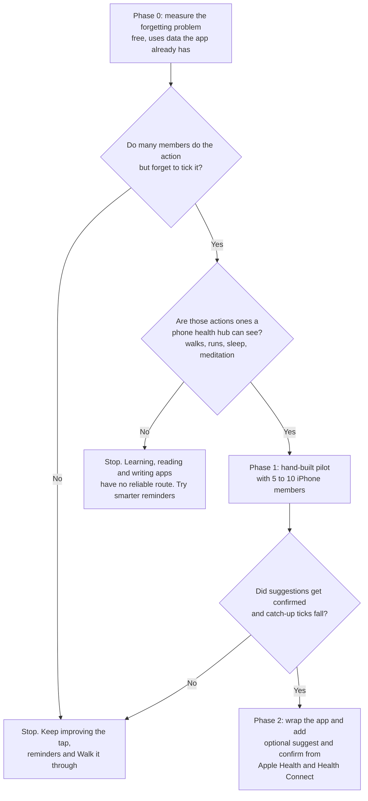

# Suggest the tick, never take it

**Bottom line.** Integrations are not worth building yet, and the evidence does not support a broad "connect everything" programme. The headline evidence for automatic data import is one large observational study: people whose data uploaded automatically stayed engaged about **four times longer**, but they chose to connect and were paid reward points to do it ([JMIR 2016](https://www.jmir.org/2016/11/e292)). The best randomised trial found that adding a wearable to manual self-monitoring produced **less** weight loss over two years ([ScienceDaily](https://www.sciencedaily.com/releases/2016/09/160920131932.htm)). A meta-analysis of 138 studies found that monitoring progress works best when it is **physically recorded** ([APA](https://www.apa.org/news/press/releases/2015/10/progress-goals)), and that is exactly what the "I showed up today" tap already does. No study was found that tests "connect your apps" against manual ticking for retention in a habit app. The technical picture points the same way. The two phone health hubs (Apple Health and Health Connect) cover most body habits through two connections, but neither can be read by a web app ([DEV Community](https://dev.to/rudratosh/apple-wont-give-you-an-api-for-your-health-data-a-free-shortcut-will-heres-the-whole-pipeline-1j9k)). Nothing reliable reaches Duolingo, Kindle, Speechify or writing apps ([PyPI](https://pypi.org/project/duolingo-api/0.5.2/), [Slashdot](https://developers.slashdot.org/story/20/12/17/1522242/goodreads-is-retiring-its-current-api-and-book-loving-developers-arent-happy)). Direct connections to single brands have broken repeatedly since 2024. *Judgement:* the right move is a cheap test with real users first. If it shows value, build one feature: an optional, off-by-default "suggest and confirm" prompt fed by the phone's health hub after the app is wrapped for the stores. Avoid direct brand APIs, aggregator subscriptions and any silent auto-ticking.

---

## The evidence favours a lighter tap, not removing the tap

The research splits cleanly by study type. The observational data looks impressive. The randomised data is sobering. Design research explains the gap between them.

| Study | Type | What it found | How much weight to give it |
|---|---|---|---|
| Walgreens Balance Rewards, 455,341 users ([JMIR 2016](https://jmir.org/2016/11/e292/PDF)) | Observational, **company co-authored** | Automatic uploaders: 24.0 weeks of participation vs 10.5 for manual loggers. Active weeks 20.2 vs 5.2. The gap appeared for exercise, sleep and weight. There was none for blood pressure or glucose, where automatic upload was rare. | Low for cause. Users chose to connect and earned 250 points for doing so, the comparison was unadjusted, and Walgreens staff were authors. It measures data arriving, not people choosing to engage. |
| IDEA trial, 470 adults, 24 months ([ScienceDaily](https://www.sciencedaily.com/releases/2016/09/160920131932.htm), [NHLBI record](https://biolincc.nhlbi.nih.gov/studies/idea)) | Randomised controlled trial | Adding a wearable to manual self-monitoring: 3.5 kg lost vs 5.9 kg without it | High that automation is not automatically better. It does not prove automation is worse for a habit app, because the outcome was weight. |
| Harkin et al., 138 studies, 19,951 people ([APA](https://www.apa.org/news/press/releases/2015/10/progress-goals), [eprint](https://eprints.whiterose.ac.uk/91437/)) | Meta-analysis | Monitoring progress improves goal attainment, with an "even greater effect" when progress is physically recorded or publicly reported | High. This is the strongest finding in the research. |
| Choe et al., semi-automated tracking ([PDF](https://users.ece.utexas.edu/~ethomaz/papers/j1.pdf)) | Expert position paper, no new data | Full automation likely "significantly reduces the awareness, accountability, and involvement" that manual tracking gives. The authors recommend blending a light manual step with automatic capture. | Medium. This is expert consensus, not an experiment. |
| Epstein et al., 168 surveyed plus 22 interviews ([PDF](https://my.eng.utah.edu/~cs5540/au16/readings/PersonalInformatics-Epstein2015.pdf)) | Qualitative | 44% of activity trackers were abandoned within three months, despite automatic capture. Manual finance trackers were the most persistent (26% abandoned). Passive tools keep collecting after the person has mentally left. | Medium. It shows that automation alone does not solve drop-off. |

Two points matter most for Let's Go!. First, **forgetting is a named lapse type** alongside upkeep (charging devices), skipping and suspending ([Epstein 2015](https://my.eng.utah.edu/~cs5540/au16/readings/PersonalInformatics-Epstein2015.pdf)), so a prompt that catches a forgotten tick addresses a real failure. Second, about half of lapsed Fitbit users felt **guilt or frustration** about stopping, 97% of that group would consider coming back, and they found prompts about barriers judgemental ([Epstein 2016](https://homes.cs.washington.edu/~jfogarty/publications/ubicomp2016.pdf)). *Judgement:* this supports the app's existing choice to count comebacks rather than streaks. It also warns that an integration which shows empty "no data" days would bring the guilt back.

Industry baselines show why any lever is tempting. Health and fitness apps keep only **3% to 8% of users at day 30** ([Business of Apps](https://businessofapps.com/data/health-fitness-app-benchmarks)). No retention figures linking integrations to staying power were found from Strava, Habitify, Streaks, Duolingo or Garmin. The only other numbers come from companies that sell integrations, such as Terra and Sahha (**vendor claims**, with no independent data on their pages: [Terra](https://tryterra.co/wearable-data-api), [Sahha](https://sahha.ai/compare/terra-alternatives/)).

### ADHD and anxiety: the evidence is thin and pulls both ways

No study compares automatic and manual tracking for people with ADHD or anxiety. A small 2026 preprint (six participants, not peer reviewed) found that self-tracking placed "substantial interpretive and emotional demands" on autistic and ADHD people ([arXiv](https://arxiv.org/abs/2603.22609)). A randomised study of 109 adults with ADHD found that SMS reminders did not improve overall completion ([Frontiers](https://www.frontiersin.org/articles/10.3389/fdgth.2022.821031/text)). Users' own posts pull the other way. In one r/ADHD thread, all four replies recommended passive tools, and the one founder who replied kept a short manual check-in alongside the health data ([r/ADHD mirror](https://reddit.sentinel-team.org/posts/1rhfkyh/snapshots/2026-03-02T22%3A12%3A06.377965Z)). Another ADHD thread asked for "Not a score. Not a broken streak." and was answered with a recommendation for pen and paper ([r/ADHD mirror](https://reddit.sentinel-team.org/posts/1tdu6e1/snapshots/2026-05-15T18%3A50%3A52.587668Z)). *Judgement:* both camps are served by an optional connection that suggests a tick, is never part of setup, and never presents a missing reading as a gap.

## More data streams mean more noise in "Patterns worth noticing"

The one peer-reviewed study of a multi-source aggregator used 20 real Exist users who connected Fitbit, RescueTime, Last.fm, calendar, weather and mood for three months. Each person was shown an average of **62 correlations**, and most were not found interesting. At least four became frustrated, and one described "analysis paralysis". Surprising, useful and **cross-category** links, such as sleep against mood, were the ones people valued. Strict filtering cut the number shown by about 55% and raised the share rated interesting to about **81%** ([Jones and Kelly 2018, open PDF](https://core.ac.uk/download/161917369.pdf)). Exist itself once refused Apple Health sleep data because mixed sources produced "garbage in, garbage out" correlations ([Exist on Medium](https://medium.com/exist-stories/apple-health-isn-t-private-it-s-painful-6ef90834a61d)).

*Judgement:* this supports V2's strict, sparse Patterns design as it stands. The only real argument for importing a data stream is one cross-category link, such as "you show up more after nights with 7+ hours' sleep". That is a later, optional extra, not a reason to start. With n = 20, treat this as design guidance rather than a measured retention effect.

## Two phone hubs reach most body habits; nothing reaches Duolingo

The leading habit apps all follow the same pattern: the phone's health hub, a handful of direct brand APIs, and a do-it-yourself escape hatch.

| App | How it connects | Source |
|---|---|---|
| Streaks (iPhone only) | Apple Health, 80+ data types; Shortcuts; Screen Time | [App Store](https://apps.apple.com/us/app/streaks/id963034692) |
| Habitify | Apple Health, Strava, Fitbit, RescueTime, IFTTT, public API | [Changelog, Mar 2026](https://feedback.habitify.me/changelog/habitify-ios-340-api-v2-higher-goals-and-better-sync), [IFTTT](https://ifttt.com/explore/best-habit-tracker-apps) |
| Exist.io | 17 sources, including both hubs, Todoist, GitHub, Strava and Oura | [Exist](https://exist.io/apps-data-syncing/) |
| Bearable | Fitbit directly; everything else through the hubs | [Bearable](https://bearable.app/support/howto/sync-with-other-devices/) |
| Finch | No integrations listed | [App Store](https://apps.apple.com/us/app/finch-self-care-pet/id1528595748) |

*Judgement:* Exist's breadth took about a decade of app-by-app building, which is exactly the Pandora's box to avoid. Finch shows that a gentle, popular habit app can thrive with none.

The table below compares every route on reach, effort and risk.

| Route | What it covers | Works as today's web app? | Build effort (*judgement*) | Effort for the member | Main risk |
|---|---|---|---|---|---|
| **Phone health hubs** (Apple Health, Health Connect) | Steps, workouts, sleep, mindful minutes. Samsung Health ([Samsung](https://developer.samsung.com/health/blog/en/accessing-samsung-health-data-through-health-connect)), Headspace and Calm ([Headspace](https://help.headspace.com/hc/en-us/articles/115003793088-How-do-I-connect-Headspace-to-the-iOS-Health-App), [Calm](https://support.calm.com/hc/en-us/articles/115005140814-Apple-Health)), Garmin, Oura and Strava data arrive through them | **No.** Needs a native app; a Capacitor wrapper is enough ([Capgo](https://capgo.app/blog/google-fit-to-health-connect-migration-in-capacitor/)) | Days to wrap, then 2 to 6 weeks elapsed, mostly waiting on stores | One permission screen | Store review, silent permission loss |
| **Personal webhook link plus a ready-made iPhone Shortcut** | Any iPhone app via the "App opened/closed" trigger, which now runs without asking ([Apple](https://support.apple.com/en-gb/guide/shortcuts/apd602971e63/ios)), so it covers Duolingo, Kindle and Speechify. Also anything Zapier, IFTTT or Tasker can see | **Yes** | About a day | Fiddly; iPhone only | Silent failures; Zapier webhooks need a $19.99+ a month plan ([DEV](https://dev.to/trackstack/zapier-free-plan-in-2026-what-100-tasks-actually-buy-you-3h8k)) |
| **Direct brand APIs** (Strava, Todoist, Garmin) | One brand each | Yes (server side) | Weeks each, plus approval | OAuth sign-in per brand | Rule changes, shutdowns, waiting lists (next section) |
| **Aggregators** (Terra, ROOK, Junction, Sahha) | Wearables only | Still need the phone SDK for the hubs ([Sahha, a competitor's comparison](https://sahha.ai/compare/terra-alternatives/)) | Medium | Varies | **$300 to $500 a month** ([Junction](https://www.junction.com/pricing), [Terra docs](https://docs.tryterra.co/health-and-fitness-api/pricing)) |
| **Learning, reading and writing apps directly** | Duolingo: unofficial scrapers only ([PyPI](https://pypi.org/project/duolingo-api/0.5.2/)). Goodreads: closed to new developers since 2020 ([Slashdot](https://developers.slashdot.org/story/20/12/17/1522242/goodreads-is-retiring-its-current-api-and-book-loving-developers-arent-happy)) | n/a | Not feasible | n/a | No supported route exists |

The widest reach for the least work is the two health hubs, but only once the app is wrapped. Even then, HealthKit is "not a live stream": new data arrives when the app opens or when Health triggers a background update, and every data type needs separate consent ([Momentum](https://www.themomentum.ai/blog/what-you-can-and-cant-do-with-apple-healthkit-data)). On iPhone, a refused permission looks the same as "no data" ([Capgo](https://capgo.app/blog/google-fit-to-health-connect-migration-in-capacitor/)). This research did not verify reading a member's calendar as a route, so it is left out here.

## Users love zero effort, then blame the app when sync breaks

The delight is real and specific. "Many of the tasks can be automatically tracked... very handy since I don't like having to manually track tasks," wrote one Streaks reviewer ([App Store reviews](https://apps.apple.com/us/app/streaks/id963034692?see-all=reviews)). No source was found showing that people choose or pay for a habit app because of its integrations.

The breakage is also real, and it recurs:

| What breaks | Example | Source |
|---|---|---|
| Sync silently stops | Habitify: sync stops "after an iOS update, an app update, or when you switch to a new device". The last-resort fix "will erase the existing logs" for that habit. | [Habitify help](https://intercom.help/habitify-app/en/articles/9351979-troubleshooting-habitify-suddenly-stops-getting-data-from-apple-health) |
| Auto-complete stops after an update | Habitify medication sync broke on iOS 26.3 (Feb 2026) | [Habitify feedback](https://feedback.habitify.me/p/apple-health-medication-sync-not-marking-habit-complete-after-update) |
| Wrong count | Streaks counted toothbrushing "based on time, not instance". A Shortcut failed "100% of the time" unless the app was open. | [App Store reviews](https://apps.apple.com/us/app/streaks/id963034692?see-all=reviews) |
| Duplicates | After the Google Health app replaced Fitbit (May 2026), users reported duplicate entries across Fitbit, Fit and Strava (forum reports, unverified) | [PiunikaWeb](https://piunikaweb.com/2026/05/25/google-health-app-fitbit-backlash-missing-features-ui-changes/) |
| Forced migration | Google Fit shutdown: Habitify users had to install Health Connect and re-link every habit by hand | [Habitify help](https://intercom.help/habitify-app/en/articles/9826271-migrate-your-data-from-google-fit-to-health-connect) |

On privacy, **52% of health app users** said they were concerned about the privacy of their health information in a 2023 poll ([eMarketer, Morning Consult](https://www.emarketer.com/content/consumers-high-use-of-digital-health-tools-doesn-t-match-their-data-privacy-concerns)). *Judgement:* silent failure is worse than having no integration at all. The member did the thing, the app shows nothing, and that reads as "missed", which breaks the never-shaming rule. Fixes usually mean digging into phone settings, which is a real cost for the Focus view audience.

## Every direct connection is a dependency with a deadline

Direct brand integrations have broken often enough since 2024 that a solo owner should expect at least one forced rework a year for each one (*judgement*, based on the record below).

| Platform | What changed | Source |
|---|---|---|
| Strava | Nov 2024: roughly 30 days' notice of new terms. Data may only be shown to its owner, no AI use, and apps such as Intervals.icu had to change. | [DC Rainmaker](https://dcrainmaker.com/2024/11/stravas-changes-to-kill-off-apps.html), [road.cc](https://road.cc/content/news/strava-users-cant-publicly-share-data-third-party-apps-311329) |
| Google Fit APIs | Closed to new sign-ups since May 2024 and being shut down (sources differ on the final date: June 2025 vs end of 2026) | [Android FAQ](https://developer.android.com/health-and-fitness/health-connect/migration/fit/faq), [9to5Google](https://9to5google.com/2024/05/04/google-fit-api-shutdown/) |
| Fitbit Web API | Moving to the Google Health API, and every user must re-authorise (sources give September and 2 November 2026) | [Momentum](https://www.themomentum.ai/blog/fitbit-web-api-deprecation-google-health-migration), [Sahha](https://sahha.ai/blog/google-fit-api-sunset-migration/) |
| Garmin | Stopped taking new developer applications in spring 2026, with no reopening date | [the5krunner](https://the5krunner.com/2026/09/14/garmin-developer-api-access-paused/) |
| Oura | API access only for members with a paid Oura Membership | [Oura support](https://support.ouraring.com/hc/en-us/articles/4415266939155-The-Oura-API) |

*Judgement:* Garmin, Fitbit, Oura and Samsung all write into the two phone hubs, so reading only those hubs sidesteps every break above. This is the strongest maintenance argument in the research.

**App store risk.** Wrapping costs $99 a year for Apple and a one-time $25 for Google. New personal Google accounts must run a closed test with **12 testers for 14 days** before going live (TLR members could fill this). Apple reviews of new apps typically take 2 to 5 days, with some 2026 reports of 7 to 30+ days ([iLab](https://ilab.md/en/articles/publishing-on-the-app-store-and-google-play-in-2026-timelines-costs-and-7-hidden-requirements-that-could-derail-your-launch)). Apple rejects apps that are a "repackaged website" (Guideline 4.2, as quoted by [MobiLoud](https://www.mobiloud.com/blog/app-store-review-guidelines-webview-wrapper)). *Judgement:* Let's Go! already has push, offline use and a phone-first design, so 4.2 is a modest risk. Privacy checks (5.1.1) and delays are the bigger ones. Health data may not be used for advertising or data mining (5.1.3, [ConductAtlas capture](https://conductatlas.com/platform/apple/apple-app-store-review-guidelines/health-data-use-and-sharing-restrictions/)). Google requires a Health apps declaration that justifies each data type, using the same privacy policy everywhere ([Android Developers](https://developer.android.com/health-and-fitness/health-connect/publish)). The health plugins are young: one commercial 0.x plugin, one 14-star open-source plugin and a newly listed official one ([Capawesome](https://capawesome.io/docs/sdks/capacitor/health/), [ecosyste.ms](https://awesome.ecosyste.ms/api/v1/projects/github.com%2Fcap-go%2Fcapacitor-health), [Capacitor](https://capacitorjs.com/docs/apis/health-fitness)). Store billing rules for paid subscriptions are a separate question this research did not cover.

**UK GDPR.** Step, sleep or workout data linked to a person is health data, which makes it special category data. The workable lawful basis is **explicit consent**, given separately from other consents and naming the data involved ([ICO](https://cy.ico.org.uk/for-organisations/uk-gdpr-guidance-and-resources/lawful-basis/special-category-data/what-are-the-conditions-for-processing/)). *Judgement:* the way to keep this simple is for the phone to read the hub, decide "a walk happened", show a suggestion, and send only the confirmed tick to Supabase, as happens today. Raw health records should never be stored on the server or passed to the AI coach. Storing raw records would trigger a DPIA, consent screens, label changes and deletion paths. A DPIA is sensible anyway, because some habits ("take my medication") are already health data.

## Recommendation: test cheaply, then build one thing

Everything in this section is **judgement** drawn from the evidence above.

**Verdict:** it is not worth building now. One narrow feature is worth testing, and it is worth building only if the test clears the bar below.

| Phase | What to do | Cost | Go-on signal (*judgement thresholds*) |
|---|---|---|---|
| **0. Measure (now, free)** | Use V2's existing data. How often do people tick a past day late ("did it, forgot to tick") vs leave it empty? Add one question to the day-7 check-in: "Do you use another app for this action? Which one?" Add an honest "Connect an app: coming soon, which app?" tile in Settings and count the taps. | Hours | At least 1 in 4 active members regularly catch up on forgotten ticks, **and** most of the apps they name write to a health hub |
| **1. Hand-built pilot (2 to 4 weeks)** | For 5 to 10 iPhone members, give each a personal webhook link and a ready-made Shortcut. It never ticks; it shows "Looks like you went for a walk. Count it?" Compare catch-up ticks and show-ups with the weeks before, and ask how it felt. | About a day to build | Most suggestions confirmed, fewer catch-up ticks, nobody reports feeling watched or nagged |
| **2. Build properly** | Wrap with Capacitor for both stores. Read only steps, workouts, sleep and mindful minutes. Make it off by default, never part of setup, processed on the phone, suggest and confirm only. Show "can't see your data" as a gentle permission hint, never as a gap. | Days to build, 2 to 6 weeks of store waiting | Retention and confirm rates hold over 60 days |
| **3. Maybe, much later** | One cross-category pattern (sleep against show-ups) behind V2's strict thresholds | Small | Only if members ask for it |

**What to avoid:** silent auto-ticking, which removes the act of recording that Harkin's meta-analysis shows matters. Avoid direct brand APIs (Strava, Garmin, Fitbit, Oura), aggregator subscriptions at $300 to $500 a month, Zapier as a member-facing route, scraping Duolingo, storing raw health data, sending health data to the AI coach, and putting integrations in onboarding.

**One caution for testing:** the iPhone Shortcut route cannot be tried on an Android phone such as a Samsung, so the Phase 1 pilot needs iPhone members. Android coverage only arrives with Phase 2.

## Conclusion

The question turns out to be smaller than it first looked. It is not "should Let's Go! connect to the apps people use?" but "how many members do the thing and forget to tick it?" The app can already answer that from its own catch-up data, at no cost and before writing any integration code. If the answer is "few", the tap is doing its job, and every integration would add breakage without adding show-ups.

If the answer is "many", the evidence still argues for keeping the moment of acknowledgement and removing only the effort of remembering. A suggestion the member confirms with one tap is the one design that fits the meta-analysis, the HCI research, the ADHD user voice and the never-shaming rule together. Building it on the two phone hubs rather than brand APIs is what stops it becoming a Pandora's box. Two things remain unknown: no trial has tested suggest and confirm against silent ticking, and no data exists for people with ADHD or anxiety specifically. Let's Go!'s own pilot would be close to first-of-its-kind evidence.
